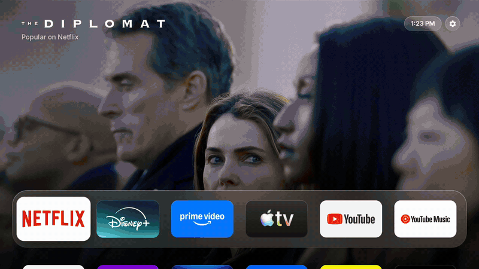
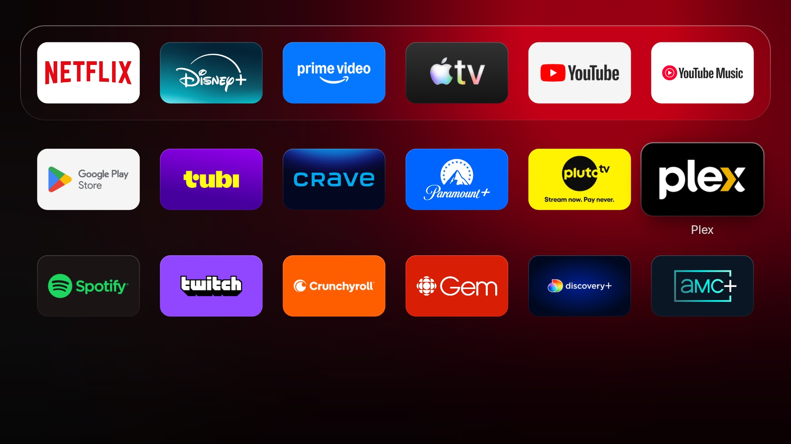
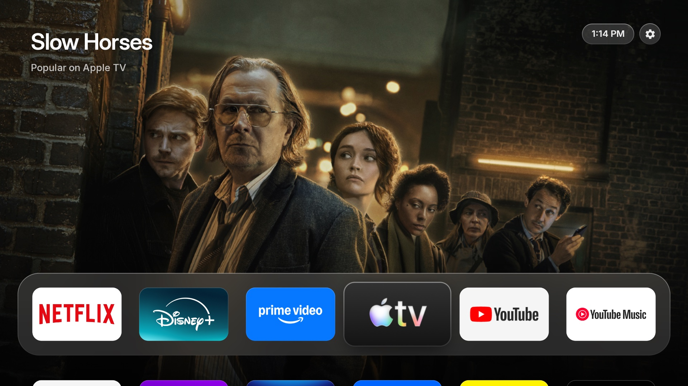

# Shelf: a tvOS-style launcher for Google TV

[](https://github.com/Manyl-Mansouri/shelf/actions/workflows/build.yml)
[](https://github.com/Manyl-Mansouri/shelf/releases/latest)

An ad-free launcher (home screen) for Google TV and Android TV, modelled on tvOS 26. It shows your apps, a Top Shelf for the app you're on, and nothing else. No ads, rows of recommendations or "For you" tabs.

> **A personal project.** Shelf was built for one TV (a TCL Google TV on Android 14, 1080p UI) and is only tested there. It should run on other Google TVs, but layout, HDMI inputs and performance may need work. Issues and pull requests are welcome, but there's no promise of support.



| Browsing the grid | Apple TV's Top Shelf |
|---|---|
|  |  |

<sub>Recorded on the Android TV emulator (smoother on a real TV), signed in to none of the services: the art is what each one has popular right now.</sub>

## How it behaves

- **Top Shelf.** The app under focus in the top row fills the screen with one thing it published: what you're partway through, else what it features. Shows are identified through Cinemeta (the free catalogue Stremio-style apps use), so you get the show's own title logo over a clean 1920×1080 background. YouTube shows a wall of the videos it recommends. Streaming apps that publish nothing (Netflix, Disney+, Prime Video) show what's popular on that service right now, from the public "Streaming Catalogs" Stremio add-on. YouTube Music shows a wall of this week's most-played albums (Apple's public charts feed), the Play Store a wall of your own apps, and the PS5 and Switch a wall of well-loved games on each (box art from Wikipedia; the console's product shot shows while it first downloads). Other apps show their logo over a glow of their brand colours. It's a picture, not a menu.
- **The dock.** The top row sits in a frosted glass dock, like tvOS: six 5:3 icons per row, each with a fine glass rim, set in Inter (the closest open typeface to Apple's SF).
- **Focus.** The focused app lifts by a fifth in about a quarter second, calm and without bounce, with a soft pool of shadow beneath it. Below the dock, its name fades in underneath.
- **Top right.** The time, and **Settings** as a glass button: press ▲ from the top row.
- **Inputs.** Devices plugged into HDMI that announce themselves (HDMI-CEC) appear as tiles, like apps, with their own marks (PS5, Nintendo Switch). Empty ports and the soundbar never show. Opening one switches the TV to it. Some devices announce the wrong port (the Switch dock is known for it): hold OK on the tile, hold OK again, and pick its real **HDMI 1–4**.
- **Browsing.** Pressing down slides the dock to the top and turns the background into a dark blurred wash of the artwork. Back returns to the top row.
- **Order.** Like tvOS: exactly the order you set, and new apps or devices go at the end. Nothing re-sorts itself.
- **Opening an app.** Like tvOS: the tile grows to fill the screen with an ease-in-out, its corners rounded until the very last frame, settling into a deep shade of the app's colour (never bright, so a white banner doesn't flash a dark room), and the app fades in over it. Coming back, the screen shrinks back into the tile, and the selection stays on the app you came from.
- **Motion.** Shelf's animations run at the speed they were designed for, even though TCL ships the TV with system animations at half speed (if animations are switched off entirely, Shelf respects that).
- **Home button.** Home from inside an app brings you back to that app's tile. Home again jumps to the first app.
- **Hidden helpers.** TCL's TV player and picture menu stay installed (inputs and the remote need them) but never appear as apps.

## Arranging and hiding apps

Like tvOS, everything happens from the remote:

| On the remote | What happens |
|---|---|
| **Hold OK** on an app | The app lifts and jiggles. A hint at the top shows the controls. |
| **◀ ▶ ▲ ▼** while it jiggles | Moves it through the grid. The other apps slide out of the way. |
| **OK** | Drops it there. The new order is saved right away. |
| **Back** | Cancels. Everything slides back to where it was. |
| **Hold OK again** while it jiggles | Opens a small menu: **Move to top row** (puts it first; shown for apps below the top row), **Hide**, **App info** (the app's page in the TV's settings) and **Uninstall** (for apps you installed; Android asks to confirm). Pick with ▲ ▼ and OK, or press Back to close the menu. |

- **Hidden apps.** Once you've hidden something, a dim **Hidden apps** tile sits at the end of the grid. Open it and press OK on an app to put it back. Restored apps return at the end of the grid. The tile disappears when nothing is hidden.
- **Settings** can be moved but not hidden, so you can always reach the TV's settings.
- New apps you install appear at the end of the grid.
- Your arrangement and hidden apps are stored on the TV. They survive restarts and updates to Shelf. Uninstalling Shelf resets them.

## Put it on your TV

Two ways to set it up:

- **From the TV alone.** Nothing to install on a computer. Google's home screen stays installed and Shelf's helper sends Home to Shelf, so you may see Google's home for a split second.
- **From a computer.** A few more steps, but Google's home screen is switched off entirely.

### From the TV alone

**1. Get Downloader.** In the Google Play Store on the TV, install **Downloader** by AFTVnews.

**2. Download Shelf.** Open Downloader, type this address and press **Go**:

```
github.com/manyl-mansouri/shelf/releases/latest/download/shelf.apk
```

The first time, Android asks to let Downloader install apps: choose **Settings** and turn on Downloader (it's also under Settings → Apps → Special app access → Install unknown apps). Then choose **Install**. Downloader offers to delete the APK afterwards; you can.

**3. Open Shelf** from your apps and choose **Allow** when it asks to read TV listings. That lets the Top Shelf show what apps publish, like what you're partway through.

**4. Make Home open Shelf.** Settings → Accessibility → **Shelf** → **Enable** → **OK**. (On some TVs it's under Settings → System → Accessibility.)

Android warns that the service "can collect all of the text you type". It shows that for every accessibility service. Shelf's helper ignores every button except Home, only checks which app is in front and whether its window is still blank, and nothing leaves the TV. It's also what gives you tvOS-style app switching (step 5 of the computer setup explains it; from the TV, it's already on).

Press Home, and you're on Shelf.

- **Updating:** do step 2 again (the address always gets the latest). Updating switches the helper off, so do step 4 again too.
- **Undoing:** switch Shelf off in Settings → Accessibility, then uninstall it from Settings → Apps.
- **TCL TVs:** TCL only lets apps it allows to "auto start" run in the background, so after a restart the helper can be on but not working (Home goes to Google's home). The computer setup below allows it.

### From a computer

You need the TV and a Mac (or Linux PC) on the same Wi-Fi.

**1. Turn on developer mode on the TV**
Settings → System → About → scroll to **Android TV OS build** and press OK on it 7 times.

**2. Turn on Wireless debugging**
Settings → System → Developer options → **Wireless debugging** → on → **Pair device with pairing code**. Leave that screen open: it shows an IP:port and a 6-digit code.

> Older Google TVs without "Wireless debugging": turn on **USB debugging** instead and use `./tv.sh connect <tv-ip>:5555` in step 3, skipping `pair`.

**3. From this folder on the Mac**

No copy of this folder yet? Download **Source code (zip)** from the [latest release](https://github.com/Manyl-Mansouri/shelf/releases/latest) and unzip it, or `git clone https://github.com/Manyl-Mansouri/shelf`. Then, in Terminal, `cd` into it.

```bash
./tv.sh pair 192.168.1.50:37123
```

Type the code shown on the TV. Then connect, using the IP:port from the main Wireless debugging screen (it's a different port from pairing):

```bash
./tv.sh connect 192.168.1.50:41234
```

Allow the prompt on the TV, then build and install:

```bash
./tv.sh install
```

No Java or Android SDK? Download `shelf.apk` from the same [release](https://github.com/Manyl-Mansouri/shelf/releases/latest) and pass it in instead (you still need `adb`, from Android's [platform tools](https://developer.android.com/tools/releases/platform-tools)):

```bash
./tv.sh install ~/Downloads/shelf.apk
```

**4. Make Home open Shelf**

Google TV doesn't let you pick another home app in Settings, so choose one of these:

| | Command | What it does |
|---|---|---|
| **A (recommended)** | `./tv.sh takeover` | Disables the stock Google TV home screen. Cleanest, with no flash when you press Home. |
| B | `./tv.sh override` | Keeps the stock home installed, and a tiny accessibility service bounces Home to Shelf. You may see a split-second flash of the old home. |

Either way, `./tv.sh restore` puts the TV back exactly as it was.

> A system update can occasionally re-enable the stock home screen. If ads come back after an update, run `./tv.sh takeover` again.

**5. Optional: tvOS-style app switching**

```bash
./tv.sh helper
```

This turns on Shelf's accessibility helper (also under Settings → Accessibility → Shelf). When you press Home, it remembers what the app looked like. Opening the app again zooms into that picture and holds it over the app until the app has really drawn, so apps like YouTube no longer flash black on reopen. Coming back, the picture shrinks into the tile. It only checks which app is in front and whether its window is still blank, and nothing leaves the TV. Without it, apps fade in over a dark shade of their colour.

## Does it work on my TV?

Probably, if it runs Google TV or Android TV, but it's only been tested on these:

| Device | Android TV OS | Status | Notes |
|---|---|---|---|
| TCL Smart TV Pro (Google TV) | 14 | ✅ Works | Shelf's daily driver, set up from a computer. For the helper to keep working after restarts, TCL needs "auto start" allowed (`./tv.sh install` does it). 1080p interface on a 4K panel. |
| Android TV emulator (Google TV image) | 14 | ✅ Works | Used for development and the screenshots above. Both setups work. |
| Fire TV | | ❓ Untested | Its home screen is Amazon's own, which Shelf's helper doesn't recognise yet. |

Tried it on something else? Please [send a device report](https://github.com/Manyl-Mansouri/shelf/issues/new?template=device-report.yml), even if everything works. It takes a minute and fills in this table.

## Things to know

- **Settings** is always on the grid (last by default, but you can move it).
- **HDMI inputs:** use your remote's Input button, or Settings → Inputs.
- **Voice search** should still work from the remote's mic button (the Assistant handles it, not the home screen).
- Option A turns off the Google TV home screen itself, so anything that only lived there (like its profile switcher) is gone until you run `restore`.

## Development

- Kotlin and Jetpack Compose. Third-party fonts and artwork, and their licences, are listed in `licenses/ATTRIBUTION.md`.
- Release builds are signed with the key named in `keystore.properties` (gitignored: `storeFile`, `storePassword`, `keyAlias`, `keyPassword`). Without that file they're signed with your local debug key.
- `./tv.sh shot` saves a screenshot from the TV.
- With both the TV and the emulator connected, pick one for `tv.sh` with `ANDROID_SERIAL=emulator-5554 ./tv.sh install`.
- Simulate holding OK: `adb shell input keyevent --longpress KEYCODE_DPAD_CENTER`.
- Emulator for testing: `$ANDROID_HOME/emulator/emulator -avd googletv`.
- `python3 tools/bench.py --reps 4 --label after` measures smoothness on the TV: Android's own missed-frame (jank) count over fixed remote sequences. Read jank, not GPU milliseconds: this TV clocks its GPU down until each frame just fits, so GPU time per frame mostly reflects the clock it chose.
- `tools/demo-apps/make.sh` fills the emulator with stand-ins for the TV's apps. `tools/demo-apps/publisher.sh <package>` makes one of them publish preview rows and "continue watching" from `content/<package>.tsv`, to test the Top Shelf. Emulator only.
- Code map:
  - `HomeScreen.kt`: navigation, tiles and focus physics, edit mode, hidden apps.
  - `Stage.kt`: the Top Shelf art, the glass dock, titles and the clock.
  - `Theme.kt`: type and layout proportions.
  - `ShelfContent.kt`: reads what apps publish (Watch Next, preview rows), identifies shows (Cinemeta) and loads artwork.
  - `Inputs.kt`: HDMI-CEC devices as tiles.
  - `Launch.kt`: the open/close zoom.
  - `AppRepository.kt` finds apps and loads artwork. It keeps the usage ordering, your manual order and the hidden set (SharedPreferences).
  - `Artwork.kt`: everything pre-rendered (Top Shelf art, logo cut-outs, blur, shadows).
  - `HomeOverrideService.kt`: the accessibility helper (app pictures on Home, the cover while an app reopens) and option B.
  - `AppSnapshots.kt`: the remembered app pictures.
  - Keys sent with `adb shell input` skip accessibility services, so the helper's Home handling only shows up with the real remote.

## License

The code is [MIT](LICENSE). Bundled fonts and artwork keep their own licences and trademarks, listed in [`licenses/ATTRIBUTION.md`](licenses/ATTRIBUTION.md). Shelf isn't affiliated with Apple, Google, TCL, Sony or Nintendo.
